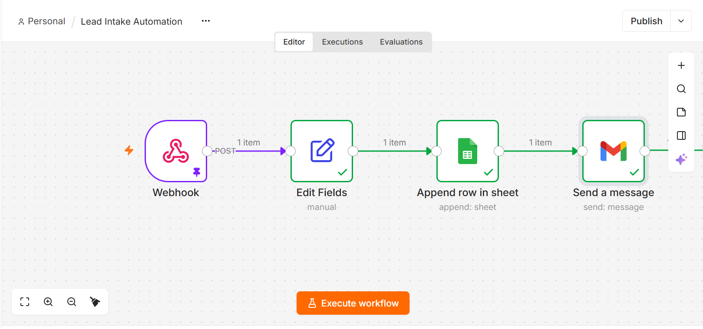
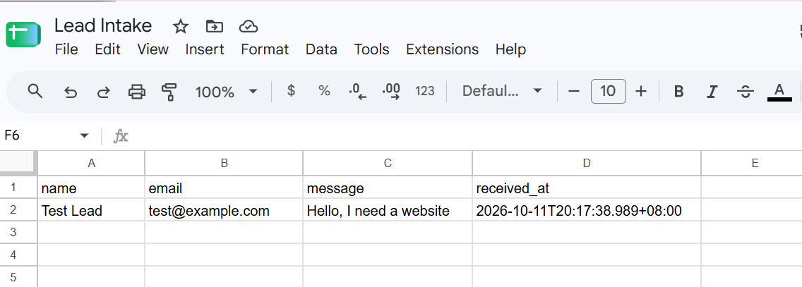
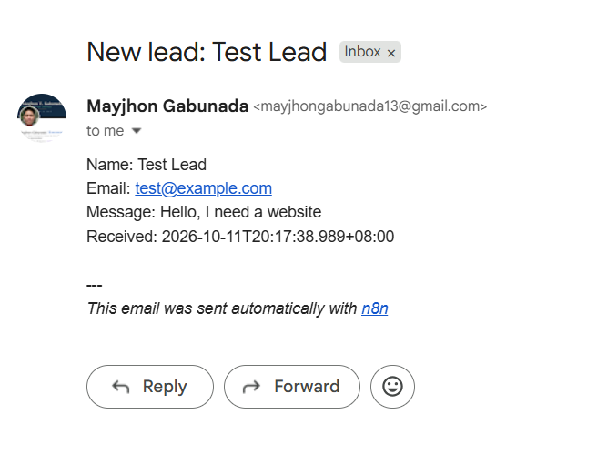

# n8n Lead Intake Automation

A small n8n workflow that takes a lead submitted through a webhook, tidies the data, logs it to a Google Sheet and sends an email notification.

I built this as a practice project while learning n8n.

## How it works

1. **Webhook (POST):** receives a lead with `name`, `email` and `message`.
2. **Edit Fields:** pulls those fields out of the request body and adds a `received_at` timestamp.
3. **Google Sheets (Append Row):** adds the lead as a new row in a "Lead Intake" sheet.
4. **Gmail (Send a message):** emails a notification with the lead's details.

## Screenshots

**Workflow**



**Google Sheet**



**Email notification**



## Example payload

```json
{
  "name": "Test Lead",
  "email": "test@example.com",
  "message": "Hello, I need a website"
}
```

## Try it yourself

1. Import `lead-intake-workflow.json` into n8n (Workflows → Import from file).
2. Create a Google Sheet named "Lead Intake" with the headers `name`, `email`, `message`, `received_at` in row 1.
3. Connect your own Google Sheets and Gmail credentials in the two nodes.
4. In the Gmail node, change the `sendTo` address from `you@example.com` to your own.
5. Send a POST request with the example payload to the webhook URL.

## Notes

- I tested the workflow in n8n using pinned sample data in the Webhook node.
- Credentials are not included in the export. You will need to connect your own.
- Possible next steps: spam filtering, an AI node to classify leads as hot, warm or cold, and error handling.

## Tools

n8n Cloud, Google Sheets, Gmail
